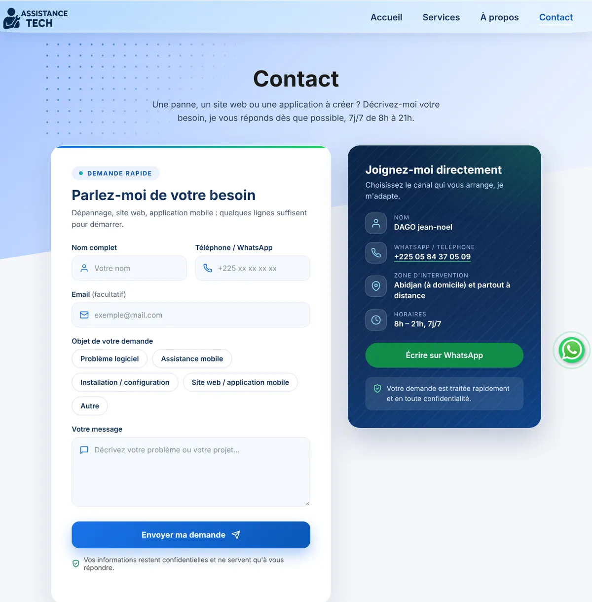

# DEV NOEL — Assistance informatique, développement web & mobile

Site vitrine de **DEV NOEL**, développeur web & mobile et assistant informatique à **Abidjan** (Côte d'Ivoire) : dépannage à domicile ou à distance, création de sites web et d'applications mobiles.

**🔗 Site en ligne : <https://devnoel1.github.io/DEVNOEL_services/>**


---

## Sommaire

- [Fonctionnalités](#fonctionnalités)
- [Aperçus](#aperçus)
- [Stack technique](#stack-technique)
- [Structure du projet](#structure-du-projet)
- [Lancer le site en local](#lancer-le-site-en-local)
- [Configuration](#configuration)
- [Personnalisation](#personnalisation)
- [SEO et accessibilité](#seo-et-accessibilité)
- [Déploiement sur GitHub Pages](#déploiement-sur-github-pages)
- [Pistes d'amélioration](#pistes-damélioration)

---

## Fonctionnalités

- **4 pages + 1 page de remerciement** : Accueil, Services, À propos, Contact, Merci.
- **Responsive mobile-first** : menu burger sous 758 px, hero adapté aux tablettes et petits laptops (le visage reste visible à toutes les largeurs).
- **Navigation « verre »** (glassmorphism) qui s'opacifie au défilement, barre de progression de lecture, lien actif souligné.
- **Fonds de sections travaillés en CSS pur** : bandes obliques, dégradés, halos, trames de points, séparateur diagonal sous le hero.
- **Animations modernes** : entrée orchestrée du hero, apparition au défilement avec décalage, effets de survol, menu mobile en cascade, bouton WhatsApp avec pulsation, transition douce entre les pages (*View Transitions*, sur navigateurs compatibles).
- **Formulaire de contact moderne** : champs avec icônes, objet en pastilles à choix unique, validation visuelle, bouton avec état « Envoi en cours… », anti-spam (reCAPTCHA + champ piège), envoi par [FormSubmit](https://formsubmit.co) sans serveur.
- **Conversion** : boutons WhatsApp et téléphone sur toutes les pages, bouton WhatsApp flottant, suivi des clics et des demandes envoyées dans Google Analytics.
- **Respect de `prefers-reduced-motion`** : les animations sont désactivées pour les visiteurs qui le demandent.

## Aperçus

### Accueil


### Services


### Contact



### Mobile


## Stack technique

| Domaine | Choix |
| --- | --- |
| Langages | HTML5, CSS3 (variables, `clip-path`, `backdrop-filter`, `:user-invalid`, *View Transitions*), JavaScript ES6 |
| Dépendances | **Aucune** (ni framework, ni bibliothèque, ni build) |
| Images | WebP (+ un JPG pour l'aperçu de partage) |
| Formulaire | FormSubmit (envoi par email, sans backend) |
| Statistiques | Google Analytics 4 |
| Hébergement | GitHub Pages |

Le site est volontairement 100 % statique : il se modifie avec un simple éditeur de texte.

## Structure du projet

```text
DEVNOEL_services/
├── index.html               # Accueil
├── merci.html               # Page de confirmation après envoi du formulaire (noindex)
├── robots.txt               # Règles d'exploration + lien vers le sitemap
├── sitemap.xml              # Plan du site pour Google
├── logo.ico                 # Favicon (racine, pour /favicon.ico)
├── docs/                    # Captures d'écran utilisées dans ce README
├── images/                  # Illustrations, photos, logo, image de partage (og-image.jpg)
└── src/
    ├── pages/
    │   ├── service.html     # Services
    │   ├── apropos.html     # À propos
    │   └── contact.html     # Contact + formulaire
    ├── css/
    │   ├── style.css            # Base + accueil
    │   ├── style_service.css    # Spécifique à la page Services
    │   ├── style_apropos.css    # Spécifique à la page À propos
    │   ├── style_contact.css    # Spécifique à la page Contact
    │   └── base.css             # Couche commune chargée EN DERNIER (voir ci-dessous)
    └── js/
        └── script.js        # Menu, animations, parallaxe, suivi GA, formulaire
```

### Organisation du CSS

Chaque page charge **sa feuille d'origine puis `base.css`**. `base.css` est la couche « moderne » du site : elle reprend et surcharge les styles de page (navigation en verre, hero, fonds de sections, animations, cartes services, formulaire, responsive). Elle doit donc **rester chargée en dernier** dans chaque page.

## Lancer le site en local

Aucune installation n'est nécessaire.

**Option 1 — VS Code (recommandé)** : installer l'extension *Live Server*, faire un clic droit sur `index.html` puis *Open with Live Server* (le site s'ouvre sur `http://127.0.0.1:5500/`).

**Option 2 — Python** :

```bash
python3 -m http.server 5500
# puis ouvrir http://localhost:5500
```

> Ouvrir directement les fichiers (`file://`) fonctionne pour la mise en page, mais pas pour l'envoi du formulaire ni pour les transitions entre pages : utiliser un petit serveur local.

## Configuration

Les éléments à adapter si les informations changent :

| Élément | Où le modifier |
| --- | --- |
| **Identifiant FormSubmit** (destinataire du formulaire) | `src/pages/contact.html` → attribut `action="https://formsubmit.co/…"` du `<form>`. Utiliser l'**alias aléatoire** fourni par FormSubmit plutôt que l'adresse email (elle reste ainsi invisible dans le code). Penser à cliquer sur « Activate Form » dans l'email reçu au premier envoi. |
| **Page de retour après envoi** | `src/pages/contact.html` → champ caché `_next` (URL absolue de `merci.html`). |
| **Numéro WhatsApp / téléphone** | Rechercher `2250584370509` dans les fichiers HTML (liens `wa.me` et `tel:`), plus les numéros affichés et le JSON-LD de `index.html`. |
| **Google Analytics** | Identifiant `G-S6CQMBE0SE` dans le `<head>` de chaque page. |
| **Nom de domaine / URL du site** | Balises `canonical` et `og:url`/`og:image` de chaque page, `sitemap.xml`, `robots.txt` et le JSON-LD de `index.html` (toutes utilisent l'URL `https://devnoel1.github.io/DEVNOEL_services/`). |
| **Google Search Console** | Balise `google-site-verification` dans le `<head>`. |

## Personnalisation

### Palette

Les couleurs principales sont des variables CSS déclarées en haut du bloc « FONDS DE SECTIONS » de `src/css/base.css` :

```css
:root {
  --navy: #12305c;       /* bleu marine */
  --navy-deep: #0b2447;  /* marine foncé */
  --blue: #1a73e8;       /* bleu d'action */
  --tint: #eaf1ff;       /* bleu très clair */
  --base: #f5f6fa;       /* fond de page */
}
```

### Fonds de sections

Ajouter une classe sur une `<section>` pour lui donner un fond travaillé :

| Classe | Rendu |
| --- | --- |
| `band band--glow` | Halos bleu/vert + trame de points |
| `band band--navy` | Bande marine en diagonale avec hachures |
| `band band--split` | Panneau vertical oblique + anneau décoratif |
| `band band--paper` | Bande blanche inclinée |
| `band band--cta` | Bande bleu-vert horizontale (bas de page) |
| `band band--top` | Dégradé oblique bleu en tête de page |

### Animations

- Le décalage d'apparition au défilement s'applique automatiquement aux éléments listés dans la constante `selector` de `src/js/script.js` : y ajouter un sélecteur CSS pour animer un nouvel élément.
- Les durées et courbes sont définies par `--ease-out` et `--ease-spring` dans `base.css`.

## SEO et accessibilité

**SEO**

- `<title>`, description, URL canonique et balises Open Graph / Twitter **uniques par page**.
- Données structurées `ProfessionalService` (JSON-LD) sur l'accueil.
- `sitemap.xml` + `robots.txt` ; la page `merci.html` est en `noindex`.
- Un seul `<h1>` par page, hiérarchie de titres respectée.

**Accessibilité**

- Lien d'évitement « Aller au contenu », structure sémantique (`<header>`, `<nav>`, `<main>`, `<footer>`).
- Navigation clavier avec focus visible, menu mobile avec `aria-expanded`, fermeture à la touche Échap.
- Champs de formulaire reliés à leurs `<label>`, attributs `autocomplete` adaptés.
- Textes foncés sur fonds clairs et blancs sur fonds marine, pour un bon contraste de lecture.

## Déploiement sur GitHub Pages

1. Pousser le projet sur la branche `main`.
2. Dans le dépôt : **Settings → Pages**.
3. *Source* : **Deploy from a branch**, branche `main`, dossier `/ (root)`.
4. Le site est disponible à l'adresse `https://<utilisateur>.github.io/<dépôt>/` après une à deux minutes.

Si le nom de domaine change, mettre à jour les URL listées dans [Configuration](#configuration).

## Pistes d'amélioration

- Ajouter des **tarifs** (même « à partir de… ») et des **témoignages clients** : c'est le plus gros levier de confiance pour un service local.
- Créer une fiche **Google Business Profile** pour la recherche locale à Abidjan.
- Acheter un **nom de domaine propre** (`.ci` ou `.com`) et mettre à jour les URL.
- Remplacer les illustrations qui contiennent du texte en anglais (« COMPUTER REPAIR », « SOFTWARE SUPPORT »…) et la photo « OPEN 24·7 », qui contredit les horaires affichés (8h – 21h).
- Ajouter un bandeau de consentement simple pour Google Analytics.
- Nettoyer le CSS hérité devenu inutile (règles `.crd` de `style.css`, qui servaient aux anciennes cartes « Pourquoi me choisir »).

---

Projet maintenu par **DAGO Jean-Noel** (DEV NOEL). Pour toute demande, utiliser la page [Contact](https://devnoel1.github.io/DEVNOEL_services/src/pages/contact.html) du site.
